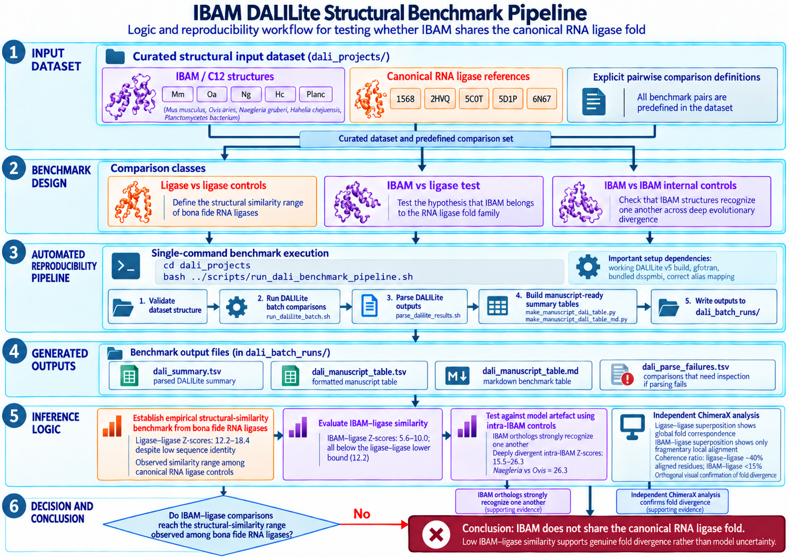

# IBAM DALILite Structural Benchmark

**Release documentation: v1.1.0 (proposed)** — automated classified DALI figures and LaTeX/ChimeraX reporting.
Version tag and GitHub release are pending repository review and commit.

This repository contains the reproducibility pipeline for the structural benchmarking analyses used in the IBAM/C12orf29 study.

C12orf29 is proposed here to encode IBAM (In Between Actin and Myosin), a contractile-system protein exhibiting a deeply conserved actomyosin interaction grammar spanning approximately one billion years of evolution.

The DALILite benchmark framework tests whether IBAM conforms to canonical RNA ligase structural families, an annotation previously proposed in the literature.

The pipeline performs systematic DALILite structural comparisons between:

- canonical RNA ligases
- IBAM vs RNA ligases
- IBAM vs IBAM homologues

The goal is to rigorously test the hypothesis that C12orf29 is structurally related to RNA ligases.
The DALILite analysis and manuscript-oriented reporting can be regenerated with a single command. ChimeraX MatchMaker measurements are imported separately; the pipeline does not run ChimeraX automatically.


---


### What's new in v1.1.0

- Classified DALI comparison tables with a `Class` column derived from an editable protein-group registry.
- Automatically generated, horizontal DALI Z-score charts (PNG, PDF and SVG) with class colours and a legend.
- LaTeX `booktabs` tables, both standalone for Overleaf and as fragments for an existing manuscript.
- Optional ChimeraX MatchMaker data joined by comparison pair (including reversed pair order), with coherence calculated as `100 × Pruned / Total`.
- Missing ChimeraX observations displayed as dashes, not estimated from DALI.
- The current project dataset contains **21 structural comparisons**, including *Fusarium virguliforme* FvCOT.

The reporting components use metadata rather than fixed protein IDs. **The DALILite batch runner still requires a manually maintained mapping to four-character DALI identifiers**; see the filename convention below.

### Benchmark workflow



DALI produces structural similarities and aligned-residue metrics; optional ChimeraX MatchMaker measurements add a distinct global-superposition perspective. Classification labels are supplied by the user-maintained registry and **are not inferred from structural similarity or evidence of enzymatic activity**.

### Repository structure

```text
IBAM_DALILite_benchmark/
├── dali_projects/                     # Input dataset (dali_* comparison folders, each with pdb/)
├── scripts/
│   ├── run_dali_benchmark_pipeline.sh
│   ├── run_dalilite_batch.sh
│   ├── parse_dalilite_results.sh
│   ├── idb_classification.py
│   ├── idb_protein_classes.tsv        # Explicit protein-group metadata
│   ├── make_manuscript_dali_table.py
│   ├── make_manuscript_dali_table_md.py
│   ├── idb_plot_zscores.py
│   └── idb_make_latex_table.py
├── chimerax_matchmaker.tsv            # Optional curated ChimeraX measurements
├── dali_batch_runs/                   # Generated timestamped results (not source input)
├── figures/
└── README.md
```

`dali_projects/` contains the reference dataset. Keep the originals intact; add new `dali_*` comparison folders rather than renaming the existing input PDBs.

---

## Species and reference-structure origins

The DALILite benchmark includes both C12/IBAM-family structures and canonical RNA ligase reference structures. The table below lists the organismal or source origin of each abbreviation used in the benchmark folder names.

| Abbreviation | Organism / source                                     | Broad lineage                            | Role in benchmark                                                                                       |
| ------------ | ----------------------------------------------------- | ---------------------------------------- | ------------------------------------------------------------------------------------------------------- |
| Mm           | *Mus musculus*                                        | Vertebrate / mammal                      | C12orf29 / IBAM-family structure; RefSeq: NP_780337.2                                                   |
| Oa           | *Ovis aries*                                          | Vertebrate / mammal                      | C12orf29 / IBAM-family structure; GBID: ADR10276                                                        |
| Ng           | *Naegleria gruberi*                                   | Discoba / Heterolobosea                  | C12/IBAM-family candidate; GenBank/RefSeq: XP_002672595.1                                               |
| Hc           | *Hahella chejuensis* NBU794                           | Bacterium / Gammaproteobacteria          | C12/IBAM-family candidate; RefSeq: WP_431686928.1                                                       |
| Planc        | *Planctomycetes* bacterium                            | Bacterium / Planctomycetota MAG          | C12/IBAM-family candidate; GBID: OHB90221.1                                                             |
| 1S68         | Tequatrovirus T4                                      | Bacteriophage                            | T4 RNA ligase 2 reference structure                                                                     |
| 2HVQ         | Tequatrovirus T4                                      | Bacteriophage                            | Adenylated full-length T4 RNA ligase 2 reference structure                                              |
| 5COT         | *Naegleria gruberi*                                   | Discoba / Heterolobosea                  | RNA ligase reference structure                                                                          |
| FvCOT        | *Fusarium virguliforme*                               | Fungus / Ascomycota                      | 5COT-like comparison structure; biological function not established by DALI alone. GBID: GBJV01001325.1 |
| 5D1P         | *Methanothermobacter thermautotrophicus* str. Delta H | Archaeon / Euryarchaeota                 | RNA ligase reference structure                                                                          |
| 6N67         | *Thermochaetoides thermophila* DSM 1495               | Bacterium / Thermotogota-related lineage | RNA ligase reference structure                                                                          |


The C12/IBAM-family structures are compared against RNA ligase reference structures to distinguish broad fold-level similarity from specific structural identity with canonical RNA ligases. The benchmark therefore includes both C12-vs-ligase comparisons and ligase-vs-ligase controls. 1S68 and 2HVQ are both Tequatrovirus T4 RNA ligase 2 structures, representing related reference structures from the same canonical RNA ligase family. They are retained as separate RNA ligase comparators but are not used as an internal 1S68-vs-2HVQ benchmark pair.


---

## Requirements

The pipeline requires:

```
Linux or macOS shell
DALILite v5 (built from source, including gfortran — see Installing DALILite below)
Python 3
Python packages: `pandas` and `matplotlib` (for the plotting stage)
```

DALILite must be available in the system `PATH` or in the batch runner's configured fallback installation directory.
Install Python plotting dependencies into your active environment, for example:

```bash
python3 -m pip install pandas matplotlib
```

Example installation location:

```
~/DaliLite/DaliLite.v5/bin/dali.pl
```

Add DALILite to the `PATH` if necessary:

```
export PATH="$HOME/DaliLite/DaliLite.v5/bin:$PATH"
```

---

## Installing DALILite

DALILite v5 is distributed as source and must be compiled locally. It requires both a C compiler and a **Fortran compiler**.

```bash
cd ~
mkdir -p DaliLite
cd DaliLite
wget http://ekhidna2.biocenter.helsinki.fi/dali/DaliLite.v5.tar.gz
tar -zxvf DaliLite.v5.tar.gz
cd DaliLite.v5/bin
make clean
make
```

`make` prints warnings that can safely be ignored. **Errors cannot be ignored** — in particular, if `gfortran` is not installed, `make` will fail partway through with `gfortran: No such file or directory` and silently skip building DALILite's core comparison binaries, while still exiting without an obvious fatal error. On Debian/Ubuntu:

```bash
sudo apt install gfortran
```

After a successful build, confirm the full binary set is present — not just the DSSP-related files:

```bash
ls ~/DaliLite/DaliLite.v5/bin/ | grep -v '\.pl$\|\.pm$\|\.o$'
```

You should see `serialcompare`, `wolf`-related helpers (via `mpicompare`), `puu`, `puutos`, `fssp`, `dsspcmbi`, and similar — not `dsspcmbi` alone. If the core binaries are missing, `make` did not complete and none of the pairwise comparisons below will run correctly.

### DSSP binary — use the bundled `dsspcmbi`, not a system DSSP install

DaliLite's importer (`import.pl`) calls a DSSP-compatible tool to compute secondary structure and solvent accessibility, configured in `bin/mpidali.pm`:

```perl
my $DSSP_EXE="$MPIDALI_BIN/dsspcmbi";
```

Leave this pointing at the **bundled `dsspcmbi`** binary built by `make` above. Do not repoint it at a system-installed `mkdssp`/DSSP 4.x package (e.g. via `apt install dssp`), even though `dsspcmbi` is an older program. Modern DSSP's output format is not fully compatible with DaliLite's downstream PUU parser and will produce **silently truncated `.dat` files** — DaliLite will report success and generate near-empty structure files with no error message, which then cause pairwise comparisons to return zero-length alignments (`Z`, `RMSD`, `lali`, `%ID` all blank in the summary table) without any indication of why.

### Validating your DALILite install

Run the built-in self-test:

```bash
cd ~/DaliLite/DaliLite.v5
./test.csh
```

**Important:** `test.csh` prints a `Result file: ...` success banner after every step *regardless of whether that step actually succeeded*. A line like:

```
* * * Result of data import: ./test/1pptA.dat * * *
cat: 1pptA.dat: No such file or directory
```

is a genuine failure, not noise — the `cat` error immediately following a "success" banner means the file was never created. Do not treat the printed banners as confirmation of success. Instead, check that the all-against-all comparison at the end of the test produces genuinely differentiated Z-scores between the structurally unrelated toy proteins (myoglobin, hemoglobin, colicin, allophycocyanin, leghemoglobin) — a matrix where every pairwise value is identical (e.g. all `0.1`) indicates the comparisons did not actually run, even if the script exits without an obvious error.

---

## Running the Benchmark

From the repository root:

```bash
cd dali_projects
bash ../scripts/run_dali_benchmark_pipeline.sh
```

The pipeline will automatically:

- validate the dataset structure
- run all DALILite pairwise structural comparisons
- parse the results
- generate classified TSV and Markdown tables
- generate coloured horizontal DALI Z-score figures in PNG, PDF and SVG
- generate a standalone LaTeX table and an insertable table fragment
- incorporate optional pre-existing ChimeraX MatchMaker measurements, if their TSV is supplied

Runtime depends on the number and complexity of comparisons and the workstation. The reference dataset has been tested with 21 comparisons.

### Comparison classifications

`scripts/idb_protein_classes.tsv` explicitly assigns each input structure to a protein group. It has two columns:

```text
Protein	Group
OaC12	C12
FvCOT	Ligase/ligase-like
```

The entries above illustrate the **current IBAM dataset**, not rules embedded in the classification code. New proteins and groups can be added by editing the registry. Comparisons are classified as within-group or between-group. If an entry is missing, it is labelled `Unclassified` rather than guessed.

The `Class` column is included in the manuscript TSV for traceability. The LaTeX table uses group headings and omits the redundant class column from each data row.

### Optional ChimeraX MatchMaker integration

The pipeline **does not execute ChimeraX**. If available, put a TSV named `chimerax_matchmaker.tsv` in the repository root (alongside `scripts/`), with these columns:

```text
Pair	Pruned	Total	GlobalRMSD
FvCOT vs 5COT	255	331	4.018
```

- `Pair` must use the same input protein names as the DALI output, separated by ` vs `; reversed order is accepted.
- `Pruned` and `Total` are the atom-pair counts reported by ChimeraX MatchMaker.
- `GlobalRMSD` is the RMSD **across all aligned pairs**, not the pruned-pair RMSD.
- Coherence is derived as `100 × Pruned / Total` and displayed to one decimal place.
- Unavailable ChimeraX comparisons are shown with dashes; nothing is imputed.
- Keep alignment settings consistent if comparing MatchMaker coherence across runs.

To use a measurement file elsewhere, set an environment variable when running the master pipeline:

```bash
IDB_CHIMERAX_TSV=/absolute/path/to/chimerax_matchmaker.tsv \
  bash ../scripts/run_dali_benchmark_pipeline.sh
```

The example measurements are specific to this dataset. For unrelated benchmark sets, supply new ChimeraX data or omit the file.

### PDB filename convention — do not shorten filenames to fit DALILite's 4-character ID limit

DALILite itself requires structure identifiers (`--pdbid`) to be exactly 4 characters, but **the input PDB files in this repository should keep their full, original filenames** (e.g. `NgC12.pdb`, `OaC12.pdb`), not shortened versions (e.g. `Ng12.pdb`, `Oa12.pdb`).

The pipeline scripts maintain their own internal mapping from these full filenames to valid 4-character DALILite identifiers. Renaming input PDB files to manually satisfy the 4-character limit breaks this mapping and will cause the batch run to fail partway through with an error such as:

```
[DALI-BATCH ERROR] No 4-char DALILite alias defined for: Ng12
```

If you are adding a new taxon or structure to the benchmark, add its alias to the mapping used by `scripts/run_dalilite_batch.sh` — do not rename the source PDB file.

---

## Output

Each benchmark execution is written to a timestamped run directory:

```text
dali_batch_runs/YYYYMMDD_HHMMSS/
```

### Generated files

Within `dali_batch_runs/YYYYMMDD_HHMMSS/results/`:

| File | Description |
|---|---|
| `dali_summary.tsv` | Parsed raw DALILite measurements |
| `dali_manuscript_table.tsv` | DALI measurements plus explicitly assigned `Class` |
| `dali_manuscript_table.md` | Markdown summary with comparison classes |
| `dali_zscores.png` | Classified horizontal Z-score figure |
| `dali_zscores.pdf` | Vector PDF version of the figure |
| `dali_zscores.svg` | Editable vector SVG |
| `dali_structural_table.tex` | Standalone, compilable Overleaf document |
| `dali_structural_table_fragment.tex` | LaTeX table for inclusion in an existing manuscript |

The terminal prints a preview of the classified benchmark table. Check for blank or unexpectedly missing measurements rather than treating process completion as proof of valid structural results.

### Manual figure or LaTeX regeneration

Run these commands **from `dali_projects/`**, substituting the appropriate prior results directory:

```bash
python3 ../scripts/idb_plot_zscores.py \
  ../dali_batch_runs/REPLACE_RUN_ID/results/dali_manuscript_table.tsv \
  --output ../dali_batch_runs/REPLACE_RUN_ID/results/dali_zscores

python3 ../scripts/idb_make_latex_table.py \
  ../dali_batch_runs/REPLACE_RUN_ID/results/dali_manuscript_table.tsv \
  --chimerax ../chimerax_matchmaker.tsv \
  --output ../dali_batch_runs/REPLACE_RUN_ID/results/dali_structural_table.tex
```

Omit `--chimerax` if no measurement TSV is available.

The standalone LaTeX output includes `\\documentclass`, `\\begin{document}` and required packages. The fragment is intended for `\\input{...}` inside an existing LaTeX document, which must load `graphicx` and `booktabs`.

The software's default table caption is deliberately generic. For the IBAM manuscript, edit the manuscript caption separately rather than hard-coding an interpretation into the generator.

---

## Reproducibility

All structural comparisons are explicitly defined in the dataset.

Running the pipeline regenerates DALI measurements, classified summary tables, Z-score plots and LaTeX exports from the input structures and recorded metadata. ChimeraX measurements remain optional, manually obtained inputs and are **not** reproduced solely by running this pipeline.

This ensures that the structural benchmark reported in the study can be fully reproduced by any reviewer or reader, provided the setup notes above — particularly the `gfortran`/DSSP requirements and the PDB naming convention — are followed. These dependencies are not enforced by the pipeline scripts themselves and can fail silently if misconfigured; see **Installing DALILite** above for how to verify a working install before trusting any output.

---

## Release notes

### v1.1.0 — planned release (11 October 2026)

Adds metadata-driven comparison classification, automatically generated horizontal Z-score figures, and Overleaf-ready LaTeX tables with optional ChimeraX MatchMaker integration. The 21-pair IBAM dataset includes FvCOT. Four-character DALILite ID mapping is still manually maintained; fully generic alias handling remains future work.

---

## Citation

If you use this repository, please cite the associated IBAM/C12orf29 study and reference this repository directly.

Friis TE. _C12orf29 encodes IBAM (In Between Actin and Myosin), a conserved actomyosin-associated protein exhibiting deeply conserved interaction grammar across eukaryotic evolution._ Manuscript in preparation.

---

## License

MIT License

Copyright (c) Thor Friis

---


## Author

Thor Friis

[](https://orcid.org/0000-0002-4132-4912)

Independent researcher, Bodø, Norway.
PhD in Molecular Biology, Queensland University of Technology (QUT).


